# VERIQ

**AI mock interviews and a coding practice arena in one full-stack app.**

VERIQ helps candidates prepare for technical interviews. Run an AI-led mock interview, get a scored report with feedback, then practice coding problems in an in-browser editor with hidden-test evaluation, all tracked from a personal dashboard.

### Live Demo 

[**Visit VERIQ →**](https://veriq-ochre.vercel.app/)

## Features

### AI mock interviews

- Configure the role, experience level, focus topics, difficulty, and duration (15, 30, 45, or 60 minutes).
- Pick a **text chat** interview or a **camera/microphone-assisted** interview.
- The AI interviewer asks follow-ups and adapts to your configured topics. The API sets a question target of 5, 10, 15, or 20 depending on duration.
- End early or let the timer run out, then generate a report: overall score, category feedback, strengths, areas to improve, and question-level evaluations.
- Interviews and reports are stored in MongoDB and can be reviewed later.

### Coding practice

- Browse problems ordered by frequency; filter by title, difficulty, and saved/solved status.
- Each problem has a description, examples, constraints, hints, and a problem-of-the-day marker.
- Write C++, Python, Java, or JavaScript in the Monaco editor.
- **Run** against a visible example, or **Submit** against hidden test cases (stored separately from problem documents).
- Bookmark problems; accepted submissions show up in your activity.

### Accounts and dashboard

- Email/password signup and login with JWT access tokens and an HTTP-only refresh-token cookie.
- Dashboard with recent activity, saved problems, and the problem of the day.
- Credit-based interviews: each new interview deducts a configured charge from your balance.

## How it works

```text
Browser (React + Vite)
  ├── REST requests with bearer access token
  └── HTTP-only refresh-token cookie
          │
          ▼
Express API
  ├── JWT auth + protected routes
  ├── Controllers + Mongoose models ──► MongoDB
  ├── Gemini ──(on 429 / 500 / 503)──► OpenRouter fallback
  └── JDoodle (code execution)
```

- **Auth:** on load, the client exchanges the refresh cookie for a short-lived access token, then fetches the current user. Protected routes are guarded on both client and server.
- **AI:** interview questions and reports are generated server-side. Gemini is called through an OpenAI-compatible client; reports are requested as JSON and saved on the interview record.
- **Code execution:** the API maps editor languages to JDoodle runtimes (C++17, Python 3, Java 17, Node.js).

## Tech stack

| Layer | Technologies |
| --- | --- |
| Client | React 19, Vite 8, React Router 7, Tailwind CSS 4 |
| Editor / UI | Monaco Editor, Lucide icons, React Hot Toast |
| API | Node.js, Express 5, Mongoose |
| Auth | bcrypt, JWT (access + refresh), HTTP-only cookies |
| Database | MongoDB |
| AI | Gemini API, OpenRouter fallback |
| Code execution | JDoodle API |

## Getting started

### Prerequisites

- Node.js 20.19+ or 22.12+, and npm
- A MongoDB database (local or hosted)
- API credentials for the features you want: Gemini (AI interviews/reports), OpenRouter (AI fallback), JDoodle (code execution)

### 1. Run the API

Create `server/.env`:

```dotenv
PORT=3000
MONGO_URI=mongodb://127.0.0.1:27017/veriq
JWT_SECRET=replace-with-a-long-random-secret
GEMINI_API_KEY=your-gemini-api-key
OPENROUTER_API_KEY=your-openrouter-api-key
JDOODLE_CLIENT_ID=your-jdoodle-client-id
JDOODLE_CLIENT_SECRET=your-jdoodle-client-secret
```

`MONGO_URI` and `JWT_SECRET` are required for the server to start. The other keys are only needed for their respective features.

```bash
cd server
npm ci
npm start
```

Visit `http://localhost:3000/`. You should see `Backend is running`.

### 2. Run the client

Create `client/.env`:

```dotenv
VITE_BASE_URL=http://localhost:3000
```

```bash
cd client
npm ci
npm run dev
```

Open `http://localhost:5173`. The API only allows this origin for credentialed CORS; if you change it, update the CORS config in `server/server.js`.

> Only put the API base URL in a `VITE_` variable. Vite exposes these in the browser bundle, so never put keys or secrets there.

### 3. Seed the coding catalog (optional)

From the `server` directory, in this order:

```bash
node seed/seedProblems.js
node seed/seedHiddenTestCase.js
```

> **Warning:** these scripts delete all existing documents in their collections (problems, then hidden test cases) before inserting the bundled data. Use a disposable database or back up first.

## Current limitations

- **The video interview is not a live video call.** It captures your local camera/mic, uses browser speech recognition for your answers and speech synthesis for the interviewer, and shows a bundled avatar clip. It needs camera/mic permission and a browser that supports `SpeechRecognition`.
- **Real-interviewer sessions are unavailable.** The option is shown disabled; the API only supports `chat` and `video` interviews.
- **The problem catalog is static.** It comes from the seed scripts; there is no automated weekly refresh.
- **Deployment needs config work.** CORS allows only `http://localhost:5173`, and refresh cookies are `httpOnly`, `secure`, and `sameSite: "strict"`. Update the origin and cookie policy for your production domains and HTTPS.
- **External services are runtime dependencies.** AI generation and code execution depend on provider credentials, availability, and quotas.

## Roadmap

- [ ] Sandboxed code execution (replacing the third-party runner)
- [ ] Resume-based interview personalization
- [ ] Working interviewer flow (scheduling, real-interviewer sessions)
- [ ] Automated tests and CI
- [ ] Production-ready CORS/cookie configuration

<details>
<summary><b>API reference</b></summary>

<br />

Protected routes need `Authorization: Bearer <access-token>`.

| Method | Path | Purpose | Auth |
| --- | --- | --- | --- |
| `GET` | `/` | Health check | No |
| `POST` | `/api/auth/signup` | Create account | No |
| `POST` | `/api/auth/login` | Log in | No |
| `POST` | `/api/auth/refresh-token` | Rotate refresh token, issue access token | Cookie |
| `GET` | `/api/auth/get-me` | Current user | Yes |
| `GET` | `/api/auth/logout` | Revoke current session | Cookie |
| `GET` | `/api/dashboard/dashboard` | Activity, saved problems, problem of the day | Yes |
| `GET` | `/api/dashboard/coding` | Problem catalog + saved/accepted IDs | Yes |
| `POST` | `/api/dashboard/coding/bookmark/:problemId` | Toggle bookmark | Yes |
| `POST` | `/api/dashboard/coding/problemDetails/:problemId` | Problem details | Yes |
| `POST` | `/api/dashboard/coding/execute` | Run sample input or submit against hidden tests | Yes |
| `POST` | `/api/dashboard/interview/create` | Create and charge for an interview | Yes |
| `POST` | `/api/dashboard/interview/getInterview/:interviewId` | Fetch interview + remaining time | Yes |
| `POST` | `/api/dashboard/interview/generateFirstQuestion/:interviewId` | Start interview | Yes |
| `POST` | `/api/dashboard/interview/nextQuestion/:interviewId` | Submit answer, get next prompt | Yes |
| `POST` | `/api/dashboard/interview/endInterview/:interviewId` | End interview | Yes |
| `POST` | `/api/dashboard/report/generateReport/:interviewId` | Generate and save report | Yes |
| `POST` | `/api/dashboard/report/getInterviewReport/:interviewId` | Fetch saved report | Yes |
| `GET` | `/api/dashboard/report/getPastInterviews` | List completed interviews | Yes |

</details>

<details>
<summary><b>Project structure</b></summary>

```text
veriq/
├── client/
│   ├── public/             # Static assets, interview avatar clip
│   └── src/
│       ├── components/     # Shared UI, landing page, problem-detail panels
│       ├── context/        # Auth context and initialization
│       ├── layout/         # Dashboard, coding, interview, report screens
│       ├── pages/          # Home, login, signup
│       └── utils/          # Problem display helpers
└── server/
    ├── configs/            # Env validation, MongoDB connection
    ├── controllers/        # Auth, dashboard/coding, interview, report handlers
    ├── middlewares/        # JWT auth, upload config
    ├── models/             # User, session, interview, problem, activity, saved data
    ├── routes/             # API route definitions
    ├── seed/               # Problem + hidden-test-case data and scripts
    └── services/           # Gemini/OpenRouter and JDoodle integrations
```

</details>

---

## Screenshots

<table>
  <tr>
    <td align="center" width="33%"><b>Landing Page</b><br />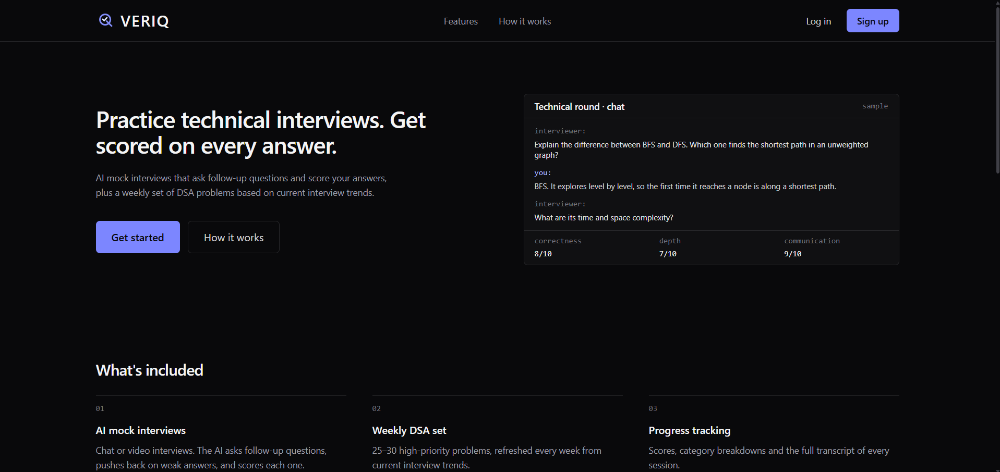</td>
    <td align="center" width="33%"><b>Signup</b><br />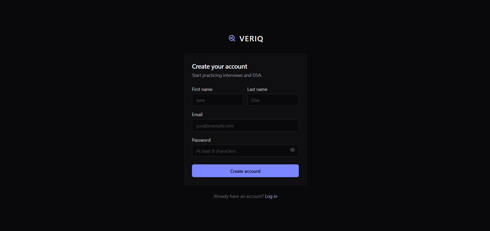</td>
    <td align="center" width="33%"><b>Dashboard</b><br />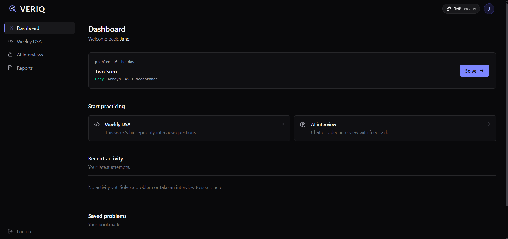</td>
  </tr>
  <tr>
    <td align="center" width="33%"><b>Coding Activity</b><br />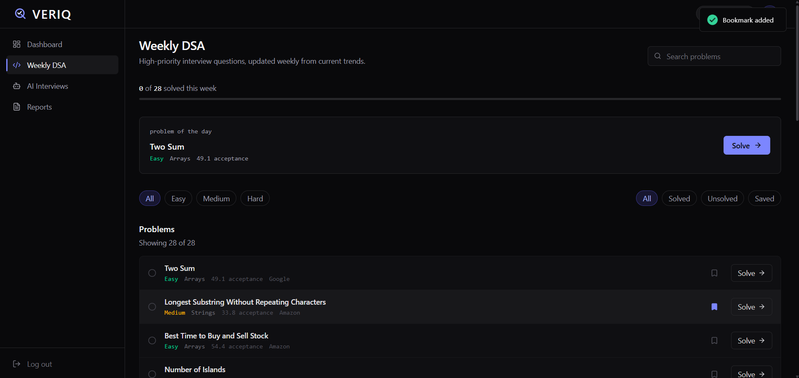</td>
    <td align="center" width="33%"><b>Problem Details</b><br />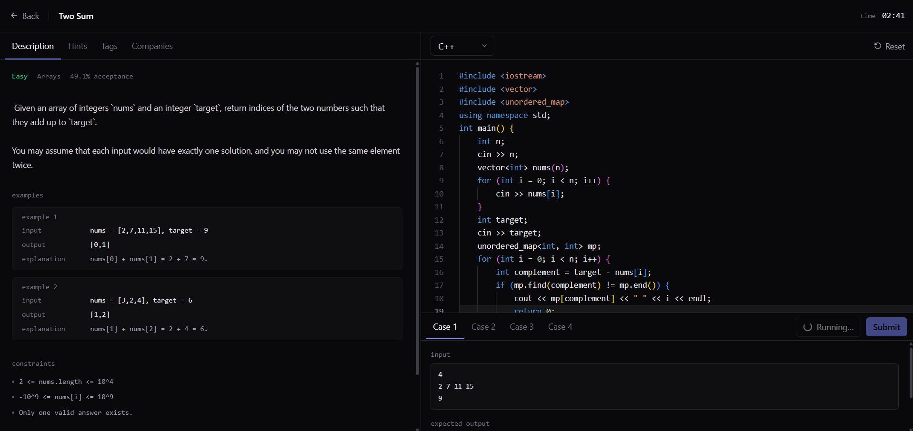</td>
    <td align="center" width="33%"><b>Interview Hub</b><br />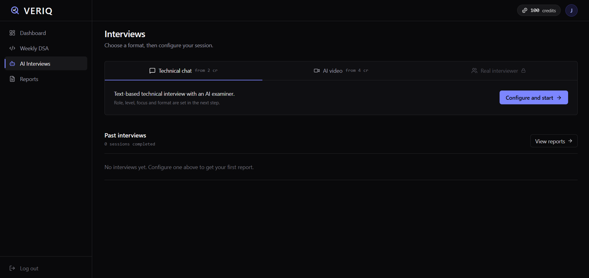</td>
  </tr>
  <tr>
    <td align="center" width="33%"><b>Technical Chat: Configure</b><br />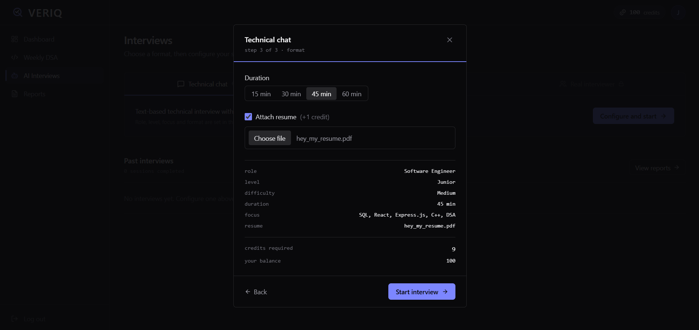</td>
    <td align="center" width="33%"><b>Technical Chat</b><br />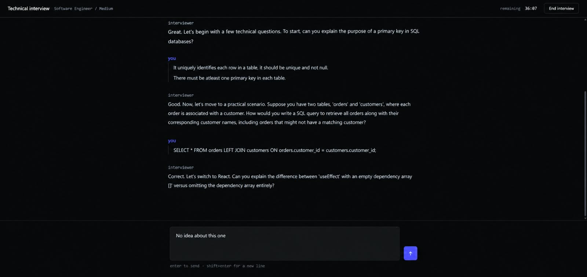</td>
    <td align="center" width="33%"><b>Technical Chat: Report</b><br />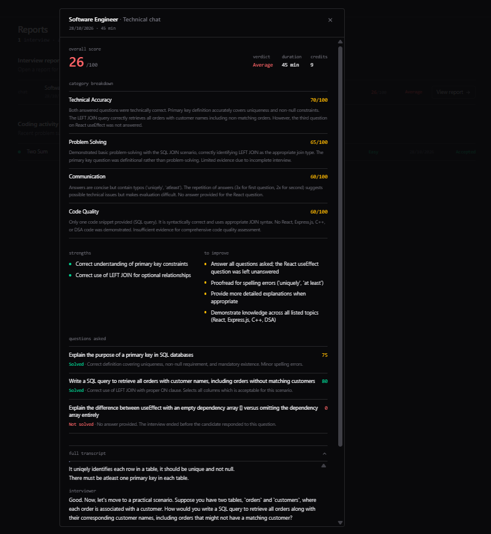</td>
  </tr>
  <tr>
    <td align="center" width="33%"><b>Video Interview: Configure</b><br />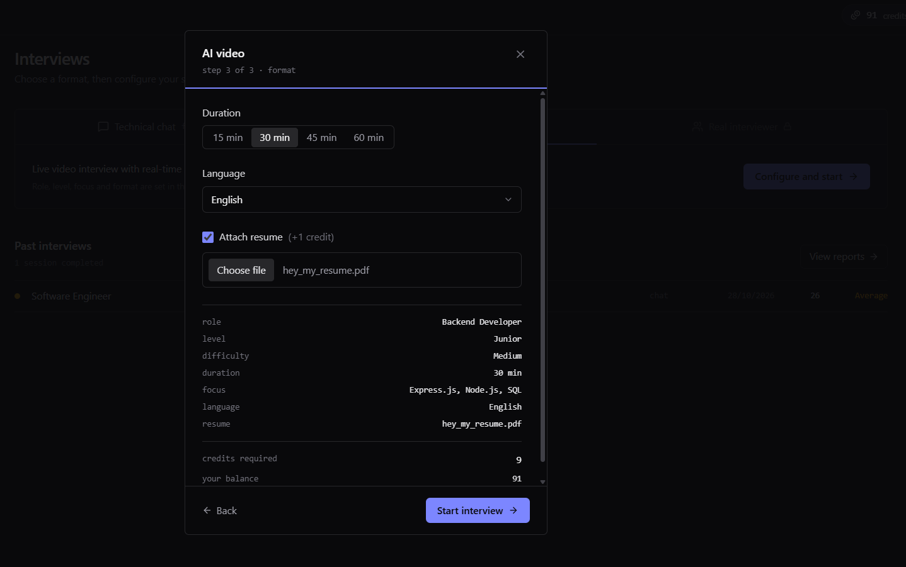</td>
    <td align="center" width="33%"><b>Video Interview</b><br />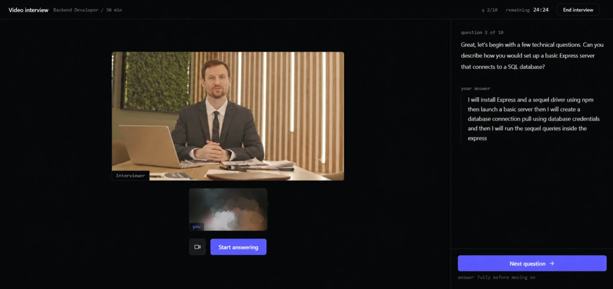</td>
    <td align="center" width="33%"><b>Video Interview: Report</b><br />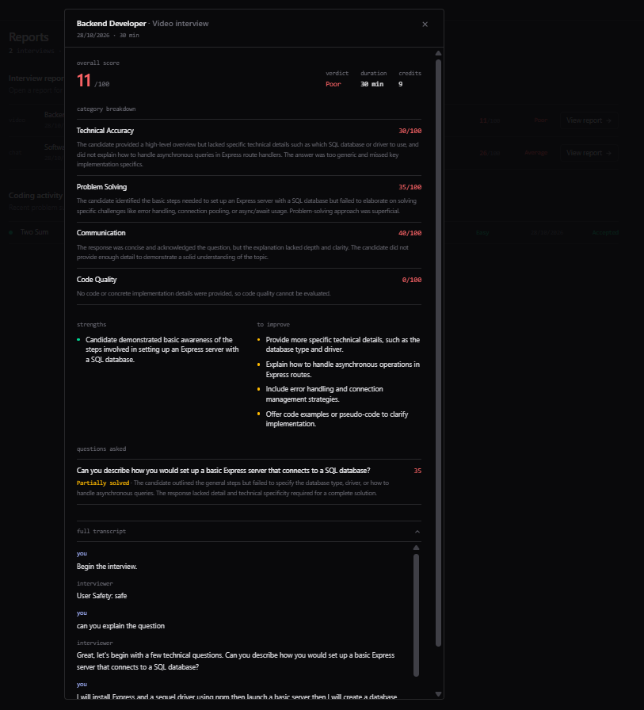</td>
  </tr>
</table>

---

Built by **Prachi** · [GitHub](https://github.com/prachinagpal7) · [LinkedIn](https://www.linkedin.com/in/prachi-nagpal-cse)
